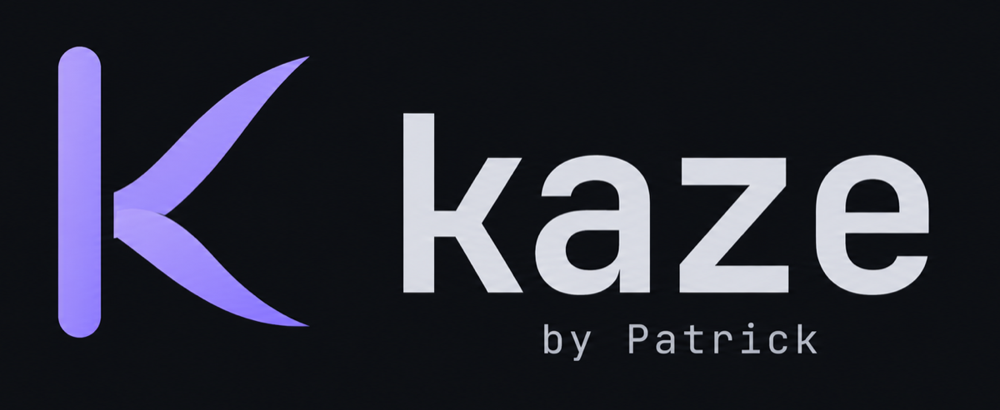

<p align="center">
  
</p>

<p align="center">
  <strong>風 · "wind"</strong><br>
  <em>Light, fast, and out of the way.</em>
</p>

kaze is my personal terminal: a small, fast terminal with a session sidebar, written in Go with
[Gio](https://gioui.org). I built it for working in [Claude Code](https://claude.com/claude-code)
all day, so it does a few things well (a sidebar of sessions, fast redraws, Japanese text, Claude Code's
symbols) and leaves out most of what a full terminal suite has. It has a small settings page for
the everyday choices, and everything it changes lives in one config file you can also edit by hand.

## Why "kaze"

Kaze (風) is Japanese for "wind". That is the feel I want from a terminal: light, quick, and
never in the way.

- **Light:** kaze draws nothing when nothing changes, so an idle window uses no CPU (0.0% with
  four tabs open) and its memory stays flat.
- **Fast:** only the rows that changed are redrawn. Replaying a Claude Code reply as it streams,
  99% of frames took 5.1ms or less to draw, well inside the 16.7ms a 60Hz screen allows.
- **Out of the way:** a sidebar of sessions, a nudge when a Claude Code session needs you or is done, and not
  much else.

These numbers were measured on Windows; the details are in
[`docs/benchmarks/2026-10-28-milestone-1.md`](docs/benchmarks/2026-10-28-milestone-1.md).

## Status

- **Windows:** works. This is what I use every day (Windows 11, PowerShell 7).
- **macOS:** works, and I use it too (Apple Silicon, zsh). Build it as an app with
  `./tools/package-macos.sh`. Still missing on the Mac: a Dock bounce for alerts, an Option-as-Alt toggle, Japanese file names with dakuten
  (macOS stores them decomposed and kaze drops the combining mark), and benchmark numbers.

## Requirements

- Go 1.27.0 or newer (see `go.mod`).
- macOS only: the Xcode Command Line Tools, because Gio uses cgo there:

  ```
  xcode-select --install
  ```

Windows needs nothing else; the Windows build uses no cgo.

## Install

### Download

Get the latest build from [Releases](https://github.com/patrick-gogo/kaze-terminal/releases/latest):
`Kaze-macOS.zip` (macOS 13 or newer, Apple Silicon and Intel), `Kaze-Windows-x64.zip` or
`Kaze-Windows-arm64.zip` (Windows 10 and 11).

kaze isn't signed by Apple or Microsoft yet, so the first launch needs one extra step:

- **macOS:** unzip, drag Kaze into Applications and open it. When macOS says it can't verify the
  app, click Done, then click **Open Anyway** next to Kaze in System Settings > Privacy & Security.
- **Windows:** unzip and run `kaze.exe`. If SmartScreen warns, click More info, then Run anyway.
  Smart App Control may block it with no way past; build it from source then.

### With Go

With Go installed, this puts a `kaze` binary in your Go bin folder (`go env GOPATH`, then `bin`):

```
go install github.com/patrick-gogo/kaze-terminal/cmd/kaze@latest
```

On Windows, add the GUI flag so no console window opens next to kaze:

```
go install -ldflags "-H=windowsgui" github.com/patrick-gogo/kaze-terminal/cmd/kaze@latest
```

## Build and run from a clone

```
git clone https://github.com/patrick-gogo/kaze-terminal.git
cd kaze-terminal
```

Windows (`-H=windowsgui` stops a console window from opening next to kaze):

```
go build -ldflags "-H=windowsgui" -o kaze.exe ./cmd/kaze
.\kaze.exe
```

macOS:

```
go build -o kaze ./cmd/kaze
./kaze
```

For the Kaze icon in the Dock, build and open the macOS app bundle instead:

```
./tools/package-macos.sh
open dist/Kaze.app
```

The app bundle is written to `dist/Kaze.app`. A bare `./kaze` binary still works, but macOS gives it a generic executable icon.

The shell is PowerShell 7 (`pwsh`) on Windows, falling back to Windows PowerShell, and your
`$SHELL` (or `/bin/zsh`) as a login shell on macOS. Set `shell` in the config to use another;
if it fails to start, kaze falls back to the default shell and says so in the first tab. If no
shell can start at all, kaze shows the error in a message box on Windows (on macOS it prints
it to stderr) and exits.

On Windows the kaze icon (exe file, taskbar, title bar, Alt+Tab) and the version details come
from `cmd/kaze/rsrc_windows_*.syso`, which `go build` picks up by itself. They are generated
from `cmd/kaze/winres/winres.json` and `assets/branding/kaze-icon-512.png`. After changing the
icon or the version, regenerate them from `cmd/kaze` (the files still say 0.6 until I rerun this):

```
go run github.com/tc-hib/go-winres@v0.3.3 make --in winres/winres.json --out rsrc --arch amd64,arm64
```

### Smart App Control (Windows)

With Smart App Control on, Windows sometimes blocks a fresh unsigned build ("An Application
Control policy has blocked this file"). Rebuild so the binary gets a different hash, for example:

```
go build -ldflags "-H=windowsgui -s -w -X main.r=12345" -o kaze.exe ./cmd/kaze
```

Change the number and rebuild until the binary is allowed. The same thing can happen to test
binaries; re-run `go test` with `-ldflags "-X main.r=<random>"`.

## Shortcuts

| Action | Windows | macOS |
|---|---|---|
| New session | Ctrl+Shift+T | Cmd+T |
| Close session | Ctrl+Shift+W | Cmd+W |
| Next session | Ctrl+Tab | Ctrl+Tab |
| Previous session | Ctrl+Shift+Tab | Ctrl+Shift+Tab |
| Hide or show the sidebar | Ctrl+Shift+B | Cmd+B |
| Jump to the next session that needs you | Ctrl+Shift+J | Cmd+J |
| Open the palette | Ctrl+Shift+K | Cmd+K |
| Show or hide the scratch shell | Ctrl+Shift+` | Ctrl+` |
| Show or hide the agents board | Ctrl+Shift+A | Cmd+Shift+A |
| Copy the selection | Ctrl+Shift+C | Cmd+C |
| Paste | Ctrl+Shift+V | Cmd+V |
| Open settings | Ctrl+, | Cmd+, |
| New line in Claude Code (without sending) | Alt+Enter | Option+Enter |

Session switching follows sidebar order, skips workspace members and scratch shells, and works
from a focused floating terminal too. If a busy terminal cannot accept more input, Kaze shows
"Input not sent"; wait for it to respond before trying again.

On macOS, Cmd+V with an image on the clipboard (a screenshot, say) pastes it into Claude Code or
Codex: kaze sends them Ctrl+V, the key they read images with. A plain shell never gets it.

Plain Ctrl+C always goes to the shell as an interrupt. In Claude Code, Shift+Enter currently
submits like Enter, so use Alt+Enter (Option+Enter on macOS) for a new line. The session, copy,
paste, sidebar, next-waiting, palette, scratch shell, agents board and settings shortcuts can be changed under `[keys]` in the
config. Settings, Shortcuts lists every shortcut as this machine has it.

## Mouse

- **Select:** drag with the left button. Copy with the copy shortcut, or turn on
  `copy_on_select` to copy when you let go. Dragging past the top or bottom edge scrolls.
- **Double-click** selects a word, **triple-click** a line. Keep dragging after the click to
  extend by words or lines.
- **Apps that use the mouse** (vim, htop and the like) get the clicks and the wheel. Hold
  **Shift** while dragging to select text in them anyway.
- **Links:** `http` and `https` links are drawn in blue with an underline (a link a program
  colored keeps its color) and show a hand cursor. Cmd+click (Ctrl+click on Windows) opens
  one in your browser, even while Claude Code or vim has the mouse. A link that wraps onto the
  next row opens whole.
- **Wheel:** scrolls back through history. Typing jumps back to the bottom. Full-screen apps
  that don't use the mouse have no history to scroll.

## The sidebar

Sessions are listed down the left side, in place of a tab strip.

- **Groups:** sessions in the same git repo sit under one header, and worktrees count as the
  same repo. Groups start open. Click a header to fold or unfold it. A folded header shows an
  amber "N waiting" when a session in it needs you.
- **Rows:** each row shows the title, a shortened folder, the branch (without a `feature/` style
  prefix) and the word `needs you` or `done` when Claude Code has something to say. Hover a row
  to get a ×, or middle click it to close it. The `+` button opens a new session.
  - **Agent:** a session running Claude Code shows the Claude logo and `claude` after the title;
    one running Codex shows the OpenAI logo and `codex`. On macOS and Linux kaze sees the program
    running in the tab, so they appear within about a second of starting, with no setup. Elsewhere
    they come from the hooks: SessionStart (`kaze notify session`) or the first prompt. Interactive
    Codex runs its hooks in a shared background server outside the tab, so its alerts need
    `codex --no-daemon` for now.
  - **Command:** when you start a prompt with a slash command, the row shows `/command` in
    magenta after the agent. This needs the prompt hook (see Alerts below).
  - **Running:** a still ring and the word `running` show that Claude is working on a prompt.
    `needs you` and `done` take priority over it. The ring does not animate, so an idle kaze
    still uses no CPU. A session counts as running from the prompt until Claude says it is done
    or needs you. When the shell prompt comes back, Claude has left and the row is a plain shell
    again. Esc to interrupt Claude fires no hook, so an interrupted row stays `running` until your
    next message.
  - **Title:** the title is your own name for the row if you set one, otherwise the slash
    command's first argument, otherwise the folder name, otherwise the shell's title.
  - **Rename:** double-click a title to edit it. Enter saves, Esc cancels, and a blank name goes
    back to the rule above. Members of a running workspace can't be renamed.
  - **Line counts:** inside a git repo, `+N -M` shows the lines added and removed against
    `HEAD` (`git diff --shortstat HEAD`). kaze runs git only when something happens (a hook
    message or the shell reporting its folder), never on a timer, with no console window and a
    2 second limit. It never takes git's index lock, so it can't break Claude's own git
    commands. Outside a repo nothing is shown.
- **Filter:** the "Filter sessions…" field at the top. Click it to type. Typing narrows the list
  by title, folder, branch and command, and folded groups open while you filter. Enter shows the first
  match (on an empty field it only gives the keyboard back). Esc clears the field and gives the
  keyboard back to the terminal. Switching or opening a session, opening Settings or hiding the
  sidebar also gives the keyboard back and keeps the text.
- **Next waiting:** the button above the Workspaces section, with its key on the right, jumps
  to the next session after the one you're on that needs you, in sidebar order, wrapping
  around. When none is waiting, the status bar says "Nothing is waiting on you."
- **Workspaces:** a section at the bottom lists each running workspace (see Workspaces below).
- **Hiding it:** the sidebar toggle (Ctrl+Shift+B, Cmd+B on macOS) hides or shows it, and kaze
  remembers the choice as `sidebar` in the config. Below 560 dp of window width it also hides
  by itself, without saving that, and the toggle does nothing until the window is wider.
- **Title bar:** Kaze draws one title bar, laid out the same on macOS and Windows. On the left,
  over the sidebar: the window buttons on macOS (the real traffic lights) or the K mark on Windows,
  the sidebar toggle and **+** for a new session. Then the session you're in (repo, title, command
  and its state), a search field that opens the palette, and on the right the scratch shell,
  Agents (with a badge) and Settings; on Windows, minimize, maximize and close follow. Drag any
  empty part of it to move the window; double-click it to zoom (macOS follows your setting) or
  maximize. Hiding the sidebar leaves the title bar's buttons where they are.

## The status bar

Along the bottom, left to right: the folder and branch of the session in front (with its lines
added and removed), then an **Update** pill when a newer kaze is out, the running subagents
(amber when one waits on you), workspace dots with how many members are up, CPU and memory
for Kaze and its sessions, Claude usage as small meters, and the tab count.
Clicking the update, agents, workspace dots or Claude usage
opens what they point at. In a narrow window the least important parts give way first: the tab
count, then the resource label and meter, then other labels, so nothing overlaps.

Hover **CPU · memory** for **Kaze resource usage**: Kaze itself first, followed by
session totals for its observable child processes, including shells, agents and
local servers. Scratch shells count under their parent session. Workspace members
have their own stable rows, labeled by workspace and member; moving a floating
pane does not change ownership. Observed processes still alive after a tab closes
keep a row marked closed. Unassigned Kaze children appear separately. External
shared services and remote processes are excluded; processes that detach before
Kaze first observes them may be missed.

CPU is a share of the whole machine, with 100% meaning all logical cores are busy.
The card names the core count. Amber starts at 50%, red at 80%, based on the last
three intervals. RAM has no meter or warning threshold. It is summed physical
footprint on macOS, including compressed memory; on Windows it is private
committed bytes, which can include paged-out memory. MB means 1,048,576 bytes and
GB means 1,024 MB. GPU is not measured. Unknown readings show **n/a**, and partial
totals have an asterisk with unavailable counts in the card. New processes warm
up for one CPU reading without making healthy totals partial.

Collection runs in the background on existing window activity, at most every two
seconds. There is no new polling timer. The card shows sample age; a completely
idle window does not wake just to refresh resources. CPU averages the time since
the preceding native counter read, even across idle gaps; the card shows that
interval. Title changes and other tabs opening or closing keep unaffected
process baselines. Sampling pauses while
minimized and resets CPU baselines on return. The card scrolls for many sessions;
in very short windows its whole content scrolls so the details remain reachable.

## Floating panes

A workspace member opens as a floating pane over the session you are in, so you can watch a
server's log without leaving your Claude session. Click its line in the sidebar, the server dots
in the status bar, or pick it in the palette.

- **Move and resize:** drag the header to move a pane, drag an edge or corner to resize it. The
  shell inside gets the new size. Panes stay inside the terminal area and shrink with the window,
  then come back to their size when it grows again.
- **Keyboard:** click a pane to bring it to the front and type into it (its border turns to the
  accent color). Click your session to take the keyboard back. Every key goes to the program in
  the pane, Esc and Ctrl+C included; kaze's own shortcuts still work.
- **Expand** makes the member the main view; pick any session to go back. **×** hides the pane;
  the member keeps running.
- **Per session:** each session remembers its own panes while kaze runs (they are not kept across
  restarts), up to 4 per session. A fifth replaces the oldest member pane. A member floats over
  one session at a time.

### The scratch shell

Ctrl+Shift+` (Ctrl+` on macOS) or the terminal button in the title bar shows a quick shell for the session in front, in
that session's folder, as a floating pane. The key hides it again; it keeps running with its
screen. Each session has its own. It is not listed in the sidebar and Ctrl+Tab skips it. If its
shell has exited, the next toggle starts a fresh one. Closing the session closes its scratch shell.
Claude Code alerts from a scratch shell count on its session's row.

## Subagents

When Claude Code hands work to subagents (Explore, Plan, general-purpose or your own agents), or
Codex starts helpers, kaze shows what each one is doing. It learns this only from their hooks; it
never reads transcript files.

- **In the sidebar:** each session lists its subagents under its row: the type, the task, how long
  it has run and the step it is on now (for example `Grep authMiddleware in src`). A ring means
  running, an amber dot means it is waiting for your approval, a green dot means done. The row
  shows a "3 agents" chip. Finished ones leave the list at your next prompt.
- **Live pane:** click a subagent to open a read-only floating pane that reads like a conversation:
  the prompt it was given, one line on what it has done so far ("Searched for 13 patterns, ran 15
  shell commands") and, when it finishes, its report (**Copy report** copies it). Individual tool
  calls aren't listed. The keyboard stays with your session. A subagent whose Agent call kaze
  missed shows no prompt.
- **The board:** every subagent in every session in three columns: running, waiting on you, and
  done. Open it with the Agents button in the sidebar, the "N agents running" text in the status
  bar, "Show agents" in the palette, or Ctrl+Shift+A (Cmd+Shift+A on macOS). Click a card to go to
  that session with the subagent's pane open; Esc or "Back to ..." returns you. A done card's ×
  removes it, and **Clear** empties the Done column (only the shown session's while filtered).
- **Setup:** it needs three more Claude Code hooks (SubagentStart, SubagentStop and a PreToolUse
  hook). Settings > Agents lists them in the setup check, and **Fix** adds them. In the main
  conversation the tool hook exits at once unless Claude starts a subagent.

## The palette

One key finds and starts things: Ctrl+Shift+K (Cmd+K on macOS), or the search field in the
middle of the title bar. Type to
narrow the list; a leading `/` is ignored and the text can match anywhere in a name or
description. It has four sections:

- **Waiting on you:** sessions where Claude is asking for something.
- **Sessions:** every other session and workspace member, with its state. Enter shows it.
- **Skills:** every skill and slash command in your Claude Code setup, recently used ones first.
- **Kaze:** kaze's own actions, and "Run workspace" for each saved workspace.

Up and Down move, Enter acts, Esc or a click outside closes. On a skill:

- **Enter** types the command into the session in front, without pressing Enter for you, when
  that session runs Claude Code and is not waiting on a permission. You add arguments and send it.
- Otherwise, or with **Shift+Enter**, kaze opens a new session in the same folder and runs
  `claude '/the-skill'` there once its shell shows a prompt. If no prompt marker arrives within
  3 seconds, the tab asks first (Run commands / Use shell); kaze never sends on a timer alone.
  PowerShell, zsh, bash and sh are supported; other shells get a message instead.

Skills come from `~/.claude/skills/*/SKILL.md`, `~/.claude/commands/**/*.md`, the same folders
under the current session's repo (`.claude/`, which win over yours), and enabled plugins in
`~/.claude/settings.json` (newest installed version only, shown as `plugin:name`). kaze only
reads these files, when the palette opens, and rereads only the ones that changed. The last 10
skills you started stay at the top while kaze runs.

## Settings

Open it with the gear button in the title bar or with Ctrl+, (Cmd+, on macOS). While it is open, a pinned Settings row sits at the top of the
sidebar, and it closes with that row's ×. Its menu on the left has:

- **Appearance:** theme cards (each a small terminal in that theme's colors), a live preview,
  font size, line spacing, cursor shape and blinking.
- **Workspaces:** saved launch recipes, one card each with its state, plus Start folder, startup and session restoration choices (see Workspaces below).
- **Agents:** shared alert choices (chimes, taskbar flash and done-toast duration), Claude usage,
  and separate setup checks for Claude Code and Codex.
- **Shortcuts:** every shortcut with its keys and config name, grouped and searchable, and kaze's
  command line (`kaze --workspace`, `kaze --version`, and the hook commands). Read-only for now.
- **Updates:** whether a newer kaze is out, and the update itself (see Updates below).
- **About:** the logo, version, platform and license.

A change applies right away and is saved when you make it. kaze edits only that one key in
`config.toml` and leaves every other line and your comments as they are, so a hand-edited file
stays yours.

### Themes

| Theme | Look |
|---|---|
| Midnight | The original: soft dark blue-black with a violet accent and rounded tabs. The default. |
| Sumi | Ink-black with warm paper text and a vermilion accent; tabs get an underline. |
| Tide | Deep navy with a turquoise accent; pill-shaped tabs. |
| Washi | The light theme: warm paper background, dark ink text, indigo accent. |
| Sakura | Dark plum with soft pink accents. |

A theme sets the terminal colors and the window colors together. Colors you set under `[colors]`
still win over the theme's terminal palette.

### Claude Code setup check

The Agents section reads `~/.claude/settings.json` and shows the state of the entries kaze
needs: the Stop hook (`notify done`), the Notification hook (`notify needs`), the prompt hook
(`notify prompt`, shown as "Command each session runs"), the status line (`statusline`), the
three subagent hooks (`notify agent-start`, `notify agent-stop` and `notify tool`, see Subagents)
and the SessionStart hook (`notify session`, which names the agent in the sidebar as soon as it opens):

| State | Meaning |
|---|---|
| OK | The entry is there and the kaze exe it points to exists. |
| missing | No kaze entry. |
| broken | A kaze entry whose exe is gone (for example after moving kaze). |
| taken | The status line is another program's. kaze never overwrites it by itself. |

**Fix** adds missing entries and repoints broken ones; **Replace** swaps another program's status
line for kaze's. Both show exactly what will change in a confirm dialog first, and write only after
you confirm. Before writing, kaze copies the file to `settings.json.bak-<date>-<time>`, and it
touches no other entry. If the file is empty or not valid JSON, kaze reports that and offers no fix.

### Codex setup check

Settings > Agents also checks Codex's `~/.codex/hooks.json` and reads inline hooks
in `~/.codex/config.toml`. If the `.codex` directory is absent, it shows **Codex
not found**. It checks these handlers:

| Codex event | Command |
|---|---|
| PermissionRequest | `kaze notify needs --agent codex` |
| Stop | `kaze notify done --agent codex` |
| UserPromptSubmit | `kaze notify prompt --agent codex` |
| Interrupt | `kaze notify interrupt --agent codex` |
| SubagentStart | `kaze notify agent-start --agent codex` |
| SubagentStop | `kaze notify agent-stop --agent codex` |
| PreToolUse | `kaze notify tool --agent codex` |
| SessionStart | `kaze notify session --agent codex` |

SessionStart shows Codex on its sidebar row as soon as it opens. SubagentStart, SubagentStop and PreToolUse show Codex helpers in the sidebar, live panes and board, like Claude Code
subagents (see Subagents). A helper is named after its `spawn_agent` task, and a helper that
gets a follow-up turn shows as running again.

**Fix** previews the changes and asks before writing. It adds missing handlers
beside other programs' hooks and repairs broken Kaze handlers. An existing file
is copied to `hooks.json.bak-<date>-<time>` first. If either source changed while
the preview was open, nothing is written. A working inline hook is left in place;
inline problems and duplicate Kaze handlers require manual repair so Kaze does
not silently install a second copy. Empty or malformed hook files are not fixed.

After Fix, **open Codex and run `/hooks` to review and trust Kaze's hooks**. The
settings check verifies configuration and executable paths, not hook trust. The
reminder stays until dismissed or Kaze restarts. Kaze never changes Codex's
`notify` command, writes its `config.toml`, or approves a Codex permission request.

Session rows and the palette show `claude` or `codex` before the submitted command.
Codex commands can start with `/` or `$` (for skills). Codex's Interrupt hook clears
`running` without a done notification; Claude's existing interrupt limitation
still applies. The shared usage switch shows **Claude** usage only. The palette's
skill catalog and skill launcher remain for Claude Code.

Codex Stop and SubagentStop print `{}` and always exit successfully, including outside Kaze.
Other hook commands are silent. The hook transport, prompt, Stop and Interrupt lifecycles were checked
with Codex CLI 0.166.0 on macOS; the helper hooks follow that version's source. Windows hook
execution still needs a manual check.

## About

Open Settings with Ctrl+, (Cmd+, on macOS), then choose **About** for the Kaze logo, version, platform and license. **Copy build info** copies the version, build and platform for a bug report; **View on GitHub** opens the repository and **Report an issue** opens a new issue.

### Updates

kaze asks GitHub for the latest release 10 seconds after it starts and then once a day while it
runs. The request carries nothing about you beyond a `kaze/<version>` user agent, and a failed check
stays quiet. Turn **Check for updates automatically** off in Settings, Updates (or set `check_updates = false`) and kaze sends
no request at all.

- When a newer version is out, the status bar shows an **Update 0.12** pill and the
  Updates menu item gets a badge. Click either for the Updates page, which says "Kaze 0.12 is
  available" with **Update and restart** and **What's new**.
- **Update and restart** asks first ("Kaze will close your 3 sessions and restart in 0.12."), then
  downloads the release's zip for your computer, checks it against the release's `SHA256SUMS`, swaps
  the new kaze in and restarts it. With session restoration enabled, conversations and folders
  reopen automatically; running commands stop. If the swap fails, the old kaze is put back. The copy it replaced
  is removed the next time kaze starts.
- It only replaces a kaze from a release download: `Kaze.app` (macOS) or `kaze.exe` (Windows),
  in a folder kaze can write to. A kaze built from a clone shows **Download**, which opens the
  release page, and the reason it can't update in place.

## Workspaces

A workspace is a saved launch recipe: a name and a list of tabs. Each tab has a title, a folder,
zero or more command lines, a color and something to wait for first. Running a workspace opens
its tabs in one go, each in its folder with its commands typed for you, so a project with an
API, a front end and a log tail starts with one click.

Make one under Settings > Workspaces: **+ New workspace**, then add tabs. The editor has two
panes: the workspace's tabs on the left (color dot, title, how many commands; a red dot marks a
tab with a problem) and the selected tab on the right. **+ Add tab** adds one in the next unused
color. For each tab:

- **Title** and **folder.** **Choose…** opens the system folder picker (Finder's on macOS,
  Explorer's on Windows) and fills in an empty title from the folder's name. You can also type or
  paste the path; folders under your home folder show as `~/...`.
- **Commands:** one numbered line per row, run in that order.
- **Color:** cyan, magenta, yellow, green, blue or red. It colors the tab's dot.
- **Wait for:** Nothing, Docker, or a port. The tab's commands are held until Docker is up, or
  until something answers on that port on this machine.

The Workspaces list shows each workspace's tabs with their color, folder, commands in order and
what they wait for. Nothing is saved until you press Save, and Cancel drops the draft. **Run** opens the tabs after
the ones you already have. If any of the workspace's tabs is still open, the button reads
**Go to tabs** and switches to the first one instead of opening copies.

### Running workspaces in the sidebar

A running workspace gets a header in the Workspaces section at the bottom of the sidebar,
reading "all up" or "N down". Click the header to fold it.

- Each member gets one line: its color bar, its title and its status. A member reads `stopped`
  in red when its commands finished or its shell exited, and `Failed` in red when its run
  failed. A member's line shows an amber dot when it needs you and a green dot when it is done;
  a folded header shows the amber one if any member needs you, else the green one. Click a
  member to float it over your session (see Floating panes below).
- The Workspaces list in Settings shows how far each member got: Starting, Waiting for Docker
  (or a port), Confirm to run, Running, Finished, Failed, Cancelled or No commands. Finished means
  the shell came back to its prompt (it needs the snippet from "Folder and branch in the status
  bar"); kaze can't tell whether the commands worked.
- Running a workspace keeps your current session in front.
- The status bar shows one dot per workspace member (green running, red down, muted otherwise)
  and a count such as "1/2 up". A closed member shows stopped and counts as down while the
  workspace still has an open tab. Click the dots to float the open member that is down, or the first open member
  if none is.
- Ctrl+Tab and Ctrl+Shift+Tab step through sessions in sidebar order and skip workspace members.
- Close a member with your close-session shortcut (Ctrl+Shift+W, Cmd+W on macOS), the × that
  shows when you hover its line, or a middle click on the line. Only a workspace run makes these lines; you can't drag ordinary sessions into one.

### How commands are sent

A tab's commands are typed as one line, then Enter. In PowerShell the lines are joined as
`a; if ($?) { b }; if ($?) { c }`, and in zsh, bash and sh as `{ a; } && { b; } && { c; }`, so a line runs only
if the one before it worked. It runs in the tab's own shell, so a venv activation or `cd` stays in
effect, the shell stays open afterwards, and the exact line shows in the shell's history. If your
shell isn't pwsh, powershell, zsh, bash or sh and any tab of the workspace has commands, kaze
refuses the whole run and shows a status-bar message naming that tab; nothing opens. (At startup
the message goes into the usual first tab instead.)

kaze types only after the shell has shown its first prompt. It knows that from the folder report
described under "Folder and branch in the status bar" below, so add that snippet to your profile
for hands-off launching. Without it, after 3 seconds the tab shows a banner with **Run commands**
and **Use shell**: the first types the commands anyway, the second leaves the tab to you. Typing in
a tab that is still waiting cancels its commands. A workspace waiting in a minimized window starts
its commands when the window is shown again.

When a tab waits for Docker, kaze starts Docker Desktop once if it isn't running. Docker and port
waits give up after 3 minutes with a message in that tab, and the commands are not run.

### The workspaces file

Workspaces are stored in `workspaces.toml` next to `config.toml`. kaze owns its layout and
rewrites it when you save, so comments are not kept. If you edit it by hand, kaze checks it
strictly when it loads; a file with a problem is reported, and kaze never overwrites it, so fix or
delete it before saving from the settings page.

### Starting kaze with a workspace

Pick one under Settings > Workspaces (`startup_workspace` in `config.toml`), or run
`kaze --workspace "My project"`. Either way kaze opens only that workspace's tabs, without the
usual plain tab. An explicit `--workspace` wins over session restoration and the startup
workspace setting. Otherwise, saved sessions restore first; the startup workspace runs when
there is nothing to restore. An unknown name opens a normal tab and shows a warning.

### Start folder for plain tabs

Under **Settings > Workspaces > Startup**, use **Start folder > Choose…** to pick the
folder for the first ordinary session and every new plain tab (Cmd+T on macOS,
Ctrl+Shift+T on Windows). **Use home** clears the override. The current path is shown
next to the controls; choosing a folder applies to subsequent tabs immediately.

You can also set `start_dir = "~/Documents"` in `config.toml`. Empty means your home
folder. `~` expands to home; relative paths resolve against the folder Kaze was
launched from. A missing folder or a path to a file falls back to home with a warning.
Changing this setting never moves existing tabs. Workspace tabs and restored sessions
keep their own folders, and the existing startup-workspace/restore precedence stays
in effect.

### Known limits

- No folder Browse button yet; type the path.
- Commands can't be reordered, only added and removed.
- Closing the window drops a workspace draft you haven't saved.

## Session restoration

Kaze automatically restores the previous sessions when you reopen it, including after
**Update and restart**. It keeps their folders, custom names, order, colors and selected
session. Claude Code and Codex reopen the exact conversations reported by their Kaze hooks;
ordinary terminals start fresh shells. Multiple conversations in one repo stay separate.
Make sure the agent hooks in Settings > Agents are configured and, for Codex, trusted.
Process detection can show an agent logo without hooks, but cannot identify its conversation.

Restoring a conversation waits for its shell's first prompt marker. Set up the shell prompt
report described above. If no marker arrives within three seconds, the session offers
**Run commands** or **Use shell**; typing first cancels automatic resumption. Kaze never
resubmits the previous prompt or replays commands. Missing folders, tools or conversation
files leave a shell and an explanation. A failed resume does not select a different chat.
The ready shell finds Claude or Codex using its own PATH, including paths set in shell startup
files when Kaze opens from Finder or restarts after an update. Missing commands and resume
errors appear in that tab as shell or agent output. The allowlisted agent command
is unquoted so shell aliases, functions and PATH installs all resolve normally.

Running commands, servers, shell variables, scrollback, scratch shells, floating layout and
live helpers do not survive exit. Workspace members reopen without replaying their recipe
commands. Kaze saves small metadata snapshots on changes, including while minimized, so it
can recover the last saved set after a crash. Changes in the last 250 ms may be lost.

Turn off **Restore sessions on launch** under Settings > Workspaces > Startup to clear the
snapshot and start fresh. Deliberately closed sessions stay closed. `sessions.json` lives
beside `config.toml`, with a limit of 128 sessions and 1 MiB; exceeded limits show a warning
and preserve the last valid snapshot. A second Kaze instance opens fresh and does not
replace the first instance's saved sessions.

## Config

kaze reads one TOML file at startup:

- Windows: `%AppData%\kaze\config.toml`
- macOS: `~/Library/Application Support/kaze/config.toml`

The file is optional. The settings page writes to it for you; restart kaze after editing it by hand.
A bad value falls back to its default and shows up as a warning in the first tab; a TOML syntax
error makes kaze use all defaults.

| Key | What it does | Default |
|---|---|---|
| `font_size` | Font size, 4 to 72 | `14` |
| `shell` | Program and arguments, e.g. `["pwsh", "-NoLogo"]` | PowerShell 7 / `$SHELL` |
| `scrollback_lines` | Lines of history per tab, up to 100000 | `10000` |
| `copy_on_select` | Copy a selection when the mouse button is released | `false` |
| `chime_needs` | Chime when Claude Code needs you (see Alerts) | `true` |
| `chime_done` | Chime when Claude Code finishes its turn | `false` |
| `chime_file` | Your own chime, a WAV file up to 2MB; `~` means your home folder | the bundled chime |
| `theme` | `midnight`, `sumi`, `tide`, `washi` or `sakura` | `midnight` |
| `line_spacing` | `tight`, `normal` or `roomy` | `normal` |
| `cursor_style` | `block`, `bar` or `underline` | `block` |
| `cursor_blink` | Blink the cursor (off keeps idle CPU at zero) | `false` |
| `taskbar_flash` | Flash the taskbar button on alerts (Windows) | `true` |
| `done_toast` | How long the "done" toast stays: `3s`, `6s`, `10s` or `until_seen` | `6s` |
| `show_usage` | Show the Claude usage readout in the status bar | `true` |
| `check_updates` | Ask GitHub once a day whether a newer kaze is out (see Updates) | `true` |
| `start_dir` | Start folder for fresh plain sessions and new plain tabs; `~` expands to home | empty, home folder |
| `restore_sessions` | Restore folders and exact Claude/Codex conversations on launch | `true` |
| `startup_workspace` | The workspace to run when kaze starts (chosen in Settings > Workspaces, stored as its ID) | none, a normal tab |
| `[colors]` | `fg`, `bg`, `cursor`, `selection`, `color0` to `color15`, as `"#rrggbb"` | the built-in Midnight palette |
| `sidebar` | Show the session sidebar (the toggle saves it here) | `true` |
| `[keys]` | `new_tab`, `close_tab`, `next_tab`, `prev_tab`, `copy`, `paste`, `toggle_sidebar`, `next_waiting`, `palette`, `scratch_shell`, `open_settings` | the shortcuts above |
| `font_family` | **Not supported yet.** Setting it only adds a warning; kaze always uses its bundled font. | |

Shortcuts are written like `"ctrl+shift+t"`. Modifiers: `ctrl`, `shift`, `alt` (or `option`),
`cmd`, `super` (or `win`). Keys: a letter or symbol, `tab`, `enter`, `space`, `esc`,
`backspace`, `delete`, `pageup`, `pagedown`, `home`, `end`, the arrows (`up`, `down`, `left`,
`right`) and `f1` to `f12`.

Example:

```toml
font_size = 15
shell = ["pwsh", "-NoLogo"]
scrollback_lines = 20000
copy_on_select = true
chime_done = true
chime_file = "~/sounds/ding.wav"

[colors]
bg = "#0f1117"

[keys]
new_tab = "ctrl+t"
```

kaze sets `TERM=xterm-256color`, `COLORTERM=truecolor` and `TERM_PROGRAM=kaze` for its shells,
plus `KAZE_TAB_ID` with the tab's number, and `KAZE_NOTIFY` (the local address kaze listens on
for alerts) with `KAZE_NOTIFY_TOKEN` (a random secret for that kaze run). Apps you launch from a
kaze tab inherit these variables too, the same way they inherit `PATH`.

## Optional shell setup

History suggestions and Tab completion come from your shell, not from kaze, so kaze leaves your
shell configuration alone. Here is how to turn them on.

### PowerShell (Windows)

PowerShell's own prediction and menu completion work well in kaze. To turn them on, add this
to your PowerShell profile (`notepad $PROFILE`):

```powershell
if ($Host.Name -eq 'ConsoleHost' -and -not [Console]::IsOutputRedirected) {
    Set-PSReadLineOption -PredictionSource History -PredictionViewStyle ListView
    Set-PSReadLineKeyHandler -Key Tab -Function MenuComplete
}
```

The guard keeps it quiet in scripts and other non-interactive sessions.

### zsh (macOS)

kaze starts your login shell, which is zsh on macOS (`/bin/zsh -l`). Tab completion is built into
zsh. Gray suggestions from your history need one plugin,
[zsh-autosuggestions](https://github.com/zsh-users/zsh-autosuggestions), which you install with
[Homebrew](https://brew.sh):

```sh
brew install zsh-autosuggestions
```

Then add this to the end of `~/.zshrc`:

```zsh
# Tab completion, with a menu you can move through with the arrow keys
autoload -Uz compinit && compinit
zstyle ':completion:*' menu select

# Gray suggestions from your history as you type; Right arrow or End accepts one
source "$(brew --prefix)/share/zsh-autosuggestions/zsh-autosuggestions.zsh"
```

If you use [Oh My Zsh](https://ohmyz.sh), it already runs `compinit`. Skip the `autoload` line,
keep the `zstyle` line, and either keep the `source` line or install the plugin the Oh My Zsh way:

```sh
git clone https://github.com/zsh-users/zsh-autosuggestions ${ZSH_CUSTOM:-~/.oh-my-zsh/custom}/plugins/zsh-autosuggestions
```

then add it to the plugin list in `~/.zshrc`, for example `plugins=(git zsh-autosuggestions)`.

To check it, open a new kaze tab (existing tabs keep the old settings):

1. Type the start of a command you ran before, such as `git st`. The rest (`atus`) appears in
   gray after the cursor. Press Right arrow to accept it.
2. Type `ls /Libr` and press Tab. zsh completes it to `/Library/`. Press Tab again to list what is
   inside, and once more to highlight an entry; move with the arrow keys and press Enter to pick.

The suggestion uses color 8 (bright black) from the active theme, so it stays dim but readable in
every kaze theme, including the light Washi.

## Folder and branch in the status bar

kaze shows the active tab's folder and git branch (`~\src\kaze  ⎇ main`) on the left of the
status bar. The shell has to tell kaze where it is with an OSC 7 sequence from its prompt.
The branch is read from `.git/HEAD` (no git process runs) whenever the prompt reports, when you
switch tabs, and when the kaze window comes back into focus, so a branch that Claude Code
switched shows up too.

PowerShell, in your profile:

```powershell
if (-not $global:__kazePrompt) { $global:__kazePrompt = $function:prompt }
function prompt {
    $segs = (Get-Location).ProviderPath.Split('\') | ForEach-Object {
        if ($_ -match '^[A-Za-z]:$') { $_ } else { [uri]::EscapeDataString($_) }
    }
    [Console]::Write([char]27 + ']7;file://' + $env:COMPUTERNAME + '/' + ($segs -join '/') + [char]7)
    & $global:__kazePrompt
}
```

It percent-encodes each folder name, so names with spaces, `#`, `%` or Japanese come through
whatever the console code page is. Loading it twice is safe. It works in PowerShell 7 and 5.1.

zsh, in `~/.zshrc`:

```zsh
_kaze_osc7() { printf '\e]7;file://%s%s\a' "$HOST" "${${${PWD//\%/%25}//\#/%23}// /%20}" }
autoload -Uz add-zsh-hook; add-zsh-hook precmd _kaze_osc7
```

Without this the folder and branch stay hidden. UNC paths (`\\server\share`) are not shown.

## Alerts (Claude Code hooks)

kaze marks a tab and shows a small toast, over the terminal to the right of the sidebar, when
Claude Code in that tab needs you (a permission prompt or a question) or has finished its turn. Click "Go ›" on the toast to switch to the tab.
"Needs you" plays a chime (unless you're already looking at that tab); "done" is silent
unless you turn on `chime_done`. While kaze is minimized, its taskbar button flashes (Windows).

kaze learns about this from Claude Code hooks that run `kaze notify`. Add them to your Claude
Code settings (`~/.claude/settings.json`), with the full path to your kaze binary:

```json
{
  "hooks": {
    "Notification": [
      {
        "matcher": "permission_prompt|elicitation_dialog|elicitation_url_dialog|agent_needs_input",
        "hooks": [
          { "type": "command", "command": "\"C:\\Users\\you\\kaze\\kaze.exe\" notify needs", "timeout": 3 }
        ]
      }
    ],
    "Stop": [
      {
        "hooks": [
          { "type": "command", "command": "\"C:\\Users\\you\\kaze\\kaze.exe\" notify done", "timeout": 3 }
        ]
      }
    ]
  }
}
```

If you already have hooks, add these entries next to them. On macOS the command is
`"/path/to/kaze" notify needs` (and `notify done`).

- **The prompt hook** is a third entry, under `UserPromptSubmit`, that runs
  `kaze.exe notify prompt` (timeout 3). It sends kaze the slash command that starts your prompt
  (like `/work-ticket`) and its first line of arguments, so the sidebar can show the command and
  mark the session as running. A prompt that does not start with a slash command sends only
  "running". **Fix** in Settings > Claude > Claude Code setup adds it, with the usual
  show-the-change, confirm and back-up steps, so you don't need to edit the file by hand. Claude
  Code adds a prompt hook's output to the conversation, so this one prints nothing at all. Its
  text is cleaned of control characters and capped before kaze shows it.
- The hooks do nothing outside kaze: `kaze notify` looks for the kaze variables, finds none
  and exits quietly, so Claude Code in another terminal is unaffected.
- `kaze notify` (including `notify prompt`) always exits 0 and prints nothing, so a hook can never block or slow Claude Code.
- Even without the matcher, kaze ignores the "idle for a minute" and "login finished"
  notifications.
- **Windows with Smart App Control:** after each rebuild, run `kaze.exe notify done` once by hand.
  That lets Smart App Control check the new exe right away, instead of during a hook, where the
  check can take longer than the 3 second timeout.

## Claude usage in the status bar

kaze shows Claude's 5-hour and weekly plan usage and how full the current tab's context is, on the
right of the status bar: a small meter and the percentage for each of 5h, wk and ctx. A meter
turns amber at 80% and red at 95%. Hover the usage for a card with each limit and when it resets;
click it for Settings, Agents.

The numbers come from Claude Code's status line. Point it at `kaze statusline` in
`~/.claude/settings.json`:

```json
{
  "statusLine": { "type": "command", "command": "\"C:\\Users\\you\\kaze\\kaze.exe\" statusline" }
}
```

On macOS the command is `"/path/to/kaze" statusline`. Claude Code allows one status line, so this
replaces any you have.

- `kaze statusline` prints the same line under Claude's prompt, so it is useful in other terminals
  too. Inside a kaze tab it also sends the numbers to kaze.
- The 5-hour and weekly numbers are for the whole account, so kaze shows the latest from any tab.
  Context is per session, so it shows only for the tab you are on, and goes away when Claude exits
  back to the shell prompt (this needs the folder snippet above).
- Plan usage appears only for Claude Pro and Max subscriptions, after the first reply in a session.
- It always exits 0 and finishes within about 300ms.

## Version

`kaze --version` prints the version and the commit and time it was built from, then exits without
opening a window. The settings page shows the version at the bottom.

`kaze --workspace "<name>"` starts kaze with that workspace's tabs (see Workspaces).

## Releases

Pushing a tag `v` + the version in `internal/version` (for example `v0.10`) runs the Release
workflow (`.github/workflows/release.yml`). It builds the universal Mac app
(`KAZE_UNIVERSAL=1 ./tools/package-macos.sh`) and the Windows exes for x64 and ARM, then publishes
them as a GitHub Release with the first-launch notes from `.github/release-notes.md`. A tag that
doesn't match the version fails before anything is published. Running the workflow by hand from
the Actions tab builds the files without releasing them.

```
git tag v0.10 && git push origin v0.10
```

## Benchmarks

Numbers for the first milestone on Windows (key latency, Claude Code streaming, launch,
scrolling, idle CPU, memory), including the goals it missed:
[docs/benchmarks/2026-10-28-milestone-1.md](docs/benchmarks/2026-10-28-milestone-1.md).
`bench/` has the harness to run them yourself.

## Roadmap

Done:

- Plan 1: the terminal core with tabs.
- Plan 3: alerts with a chime when Claude Code needs you, kaze's own title bar on Windows, and
  the current folder and git branch in the status bar.
- Plan 4: Claude's 5-hour and weekly usage and the tab's context in the status bar.
- Plan 5a: the settings page (Appearance and Claude), five themes and the Claude Code setup check.
- Plan 5b: Workspaces (launch a saved set of tabs in one click).
- Plan 6a: the session sidebar, replacing the tab strip, with repo groups, a filter and the running workspaces.
- Plan 6b: agent awareness on the rows (slash command, running mark, titles you can rename, `+N -M` line counts) and a Next waiting button and key.
- Subagents: each session's subagents in the sidebar, a live pane per subagent and the agents board (replaces Plan 2's child tabs).
- 0.16: clickable links, Codex helpers alongside Claude Code subagents, and screenshot paste with Cmd+V.
- 0.17: Claude and Codex logos on the sidebar rows as soon as an agent opens, and links drawn in blue.
- Start folder (#77): choose where new plain tabs open in Settings > Workspaces > Startup.
- 0.18: automatically reopen folders and exact Claude/Codex conversations after restart, including updates.
- 0.17.1: kaze names Claude and Codex from the program running in the tab, so the Codex logo needs no setup.
- 0.20: CPU and RAM per session in the status bar (#92); resumed conversations after updates, the update prompt layout and closed workspace status fixed (#88, #89, #90).
- 0.19.1: restored macOS session-switching shortcuts, faster subagent text wrapping, fresh helper turns, background Git lookups and bounded input queues.
- 0.19: the subagent pane shows the prompt, a one-line summary and the report; a start folder for new tabs.

Next:

- A redesign of the alert notification card (GitHub issue #9).
- Plans 6d and 6e: floating panes and a scratch shell, then the command palette. (`kaze status`, Plan 6c, is parked.)
- Real panes, which would replace the workspace section of the sidebar as the way a workspace is shown.
- The Mac milestone: run, fix and benchmark kaze on macOS.

Later:

- A browser button.
- A graph view of my notes vault.

## License

kaze's code is under the [MIT License](LICENSE). The bundled fonts in `assets/fonts`
(JetBrains Mono and a subset of Noto Sans JP) are not covered by it: each keeps its own
SIL Open Font License 1.1, in `assets/fonts/OFL-JetBrainsMono.txt` and
`assets/fonts/OFL-NotoSansJP.txt`, with sources in `assets/fonts/SOURCES.txt`.
