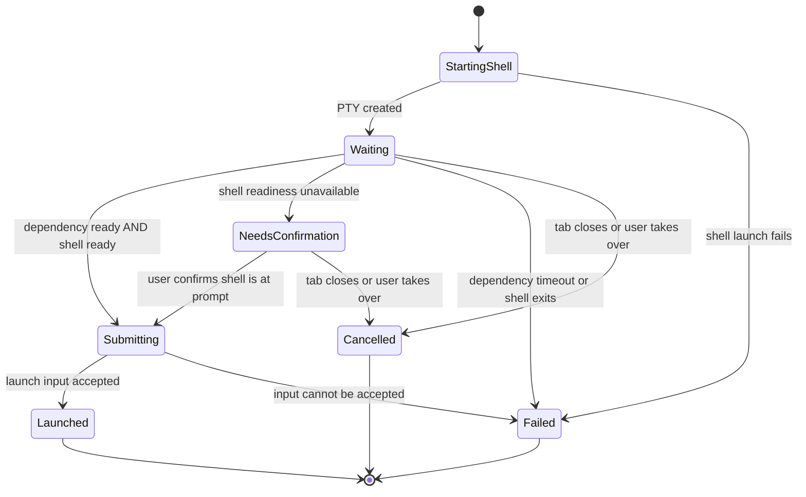

# Workspaces: product and behavior proposal

Date: 2026-10-29
Status: PROPOSED FOR REVIEW. Documentation only; not approval to implement.
Baseline: main at 04d9b82, after Settings PR #11.
Authoring request: Patrick asked for an independent, concrete Workspaces plan for Claude to review.

## Read this first

A workspace is a saved launch recipe: named terminal tabs, their folders, startup commands, colors, and readiness conditions. Run it once to prepare a project. Run it again to return to its open tabs.

This proposal elaborates Plan 5b from the approved [settings design](2026-10-29-kaze-settings-page-design.md), section 6.2. That earlier document remains approved history. Differences below are proposals requiring review, not silent replacements. The [implementation plan](../plans/2026-10-29-kaze-plan-5b-workspaces-proposal.md) gives build order and acceptance gates.

## 1. The everyday interaction

1. Open Settings > Workspaces. On a fresh install, show “No workspaces yet” and “New workspace”.
2. Create “My project”. Add tabs such as Code, API, Frontend, and Logs.
3. For each tab choose a folder, optional command lines, a color, and an optional wait condition. Show the exact commands in the editor.
4. Save. Saving changes the recipe; it never runs it.
5. Press Run. Kaze opens the tabs in saved order and focuses the first one. Each shell loads its normal profile in its own folder.
6. Tabs with readiness conditions show a static waiting state. Commands start once the dependency and the shell are ready.
7. When a dev server is interrupted, the tab remains an interactive shell with its activated environment.
8. Run the workspace again to focus the first surviving tab; do not duplicate servers or silently recreate a closed tab.

Example, using portable placeholder paths rather than an owner's machine paths:

| Tab | Folder | Commands | Wait before commands |
|---|---|---|---|
| Code | project root | `claude` | None |
| API | backend | `docker compose up -d`, then activate the environment | Docker engine |
| Frontend | frontend | `npm run dev` | Local API port 8000 |
| Logs | project root | `docker compose logs -f --tail=100 api` | Local API port 8000 |

Docker ready means its engine answers, not that the API is healthy. A TCP port means a local listener accepts a connection, not that migrations or an HTTP health check have succeeded. Commands and waits are user-selected; the app does not infer a dependency graph.

## 2. Settings and launch surfaces

Workspace list: name, tab count, current state (Closed / Starting / Open / Needs attention), Run or Go to tabs, Edit, and Delete. A partially open workspace says “2 of 4 tabs open”. “New workspace” is always available. States use text as well as color.

Editor: workspace name, ordered tab cards, Add tab, Move up/down, Remove tab, Save, and Cancel. A tab has title, folder text field plus folder chooser, six named color choices, ordered command fields with Add command, and Wait (None / Docker engine / Local port). Port is shown only for Local port. Tab and command order are keyboard accessible. Folder text remains editable if a native chooser is unavailable.

Keep edits as a draft until Save. Cancel discards the draft. Leaving a dirty editor asks Save / Discard / Keep editing. Validation appears beside the field and Save remains disabled until valid. New workspaces get no commands automatically. Switching themes preserves the draft.

Delete requires confirmation and states that existing tabs will keep running. Deleting a workspace also clears its startup selection. Editing a recipe affects future launches only. Existing tabs retain the launch snapshot, even when the recipe is renamed, edited, or deleted.

Expose saved recipes through a chevron menu beside the tab strip's plus button. The existing plus action still opens a normal tab. Menu entries support arrow keys, Enter, Escape, and click. If no recipes exist, offer Open workspace settings. A general command palette is a later feature.

Startup selection: None or one workspace, stored as an ID in config.toml. Saving a recipe or choosing startup never starts it immediately. On startup, a valid selected workspace replaces the usual home-folder tab.

## 3. Definition and validation

Store recipes in workspaces.toml beside config.toml. Kaze owns this file's formatting; write that fact in its header. config.toml continues using its existing comment-preserving single-key writer.

Proposed schema (the example commands use zsh; recipes are local to one machine):

```toml
schema_version = 1

[[workspaces]]
id = "project-a" # generated stable ID; never derived again after rename
name = "My project"

[[workspaces.tabs]]
id = "code"
title = "Code"
folder = "~/src/project"
commands = ["claude"]
color = "magenta"
wait = "none"

[[workspaces.tabs]]
id = "frontend"
title = "Frontend"
folder = "~/src/project/frontend"
commands = ["npm run dev"]
color = "cyan"
wait = "port"
port = 8000
```

- IDs are generated opaque values; example IDs above are shortened for readability. Stable IDs are used for running membership and startup selection. Names are only display labels.
- Names/titles trim outer whitespace, must be nonempty, and reject control characters. Workspace names must be unique ignoring case. Proposed bounds: name/title 80 runes, 20 tabs/workspace, 20 commands/tab, 8 KiB/command, 1 MiB/file. These are implementation bounds, not UI counters.
- Commands are one editor field per shell statement; reject embedded CR, LF, NUL, and other control characters. Ignore blank command fields on Save. Complex commands can call a user-owned script.
- Color keys: cyan, magenta, yellow, green, blue, red; map through the current theme. An alert marker temporarily wins over the saved tab color.
- Wait is none/docker/port. Port must be 1..65535 for port waits; other waits omit it. Only local loopback connections are attempted.
- Folder expands a leading tilde on the current machine. Require an absolute path after expansion, preserving spaces and Unicode. Do not expand shell variables or execute folder text.
- Folder existence is checked on Save for feedback and again on Run. Missing folders in a hand-edited file remain editable and are reported before launch; they never fall back to home silently.
- Missing file means an empty list. Invalid TOML, unsupported schema, unknown fields, duplicate IDs, and invalid values produce a readable error and disable launch/startup for that file. Preserve its bytes; do not replace it with defaults on Save. Allow Reload after external repair.
- Reload definitions when the workspace list or launch menu opens and immediately before Run. No continuous filesystem polling. If an editor's source file changed meanwhile, refuse to overwrite it; offer Reload and preserve the draft for copying.
- Write via a temporary file in the destination directory, sync and close, then rename. Preserve symlinks and existing permissions. Keep runtime state out of this file.

## 4. Launch behavior and failures

Preflight the complete launch before creating tabs: validate definition, resolve all folders and the configured shell, identify supported command adapters, and take an immutable recipe snapshot. A preflight failure opens no workspace tabs and identifies the affected field/tab.

Create tabs in saved order. Dependency waits run independently, not one tab at a time; frontend tabs must not block creation of their API tab. Keep the first successfully created workspace tab active, rather than letting every asynchronous result steal focus.

Each created tab carries workspace ID, run generation, and recipe-tab ID. A workspace is already open while any of its tracked tabs remains in the manager, including an exited tab whose output is still visible. Starting twice while creation is in progress coalesces into the same run. This scope is one Kaze process; --workspace may open another process/window as previously agreed.

Proposed tab startup state machine:



“Launched” means commands were delivered, not that the project built, the server is healthy, or Claude completed its task. Existing terminal output and process exit handling remain the source of that information.

If a later tab fails to start, retain successful tabs. Show “Started 2 of 4 tabs” and each failure; do not kill working processes to roll back. Do not automatically retry or rerun successful commands. Run again focuses the partial workspace. Closing its remaining tabs allows a fresh full run. A Retry failed tabs action is deferred.

While a tab is waiting for automatic launch, the terminal explains why and offers Use shell. If the user types, pastes, or sends a terminal mouse action before launch, cancel automatic submission for that tab before forwarding the input. Never later inject startup commands into a shell the user has taken over. Resizing, copying, searching, or merely selecting the tab does not cancel it. Closing a tab or the app cancels pending work and ignores stale completion events.

## 5. Shell readiness and command delivery

Existing OSC 7 reports a folder. It is useful evidence of profile activity, but does not prove the shell is idle: a profile can change directories before finishing. Do not assume arbitrary OSC 7 traffic is a command-completion signal.

Recommendation: install or document a small opt-in prompt hook for supported shells that reports a distinct workspace-ready marker at the end of prompt generation. Tie its event to the tab session and launch generation. Use it only for initial launch readiness, not to parse later application output. A protocol spike must establish the exact marker and ordering before implementation.

If no marker arrives after three seconds, show “Waiting for shell prompt” with Run commands and Use shell actions. The former explicitly confirms the user sees an idle prompt; it does not rerun anything already submitted. A workspace tab with no commands needs neither a readiness marker nor confirmation.

This intentionally proposes replacing the earlier automatic three-second fallback. Elapsed time alone can send commands into a profile prompt, password request, or another foreground program. See review decisions below.

Do not queue every command line into the PTY independently: later lines can become input to an earlier long-running command. Supported zsh and PowerShell adapters should submit one launch operation which executes the ordered statements in the current interactive shell context. Candidate: source/dot-source a generated private script, leaving environment activation and directory changes available in that shell. Prove this with PTY integration tests before choosing it. Do not run the launch recipe in a detached child shell.

The adapter must preserve quoting, Unicode, spaces in executable/script paths, command order, and Ctrl+C behavior. A long-running final command is supported. Treat an unsuccessful earlier statement as a launch failure and leave later statements unexecuted, using the shell's supported error semantics. Arbitrary scripts can mask their own errors; Kaze must not claim to detect those. Unsupported custom shells can open commandless tabs, but command-bearing recipes fail preflight with a clear message.

Temporary scripts are mode 0600 where supported and user-private on Windows. Keep them until the shell has read them, clean them on tab close/app shutdown, and never include command text in routine logs. Stale crash files are cleaned from Kaze's own dedicated temp directory on next startup. No deletion outside that directory.

Current term.Session.Write silently drops a full queue. Workspace launch needs a bounded, nonblocking enqueue operation that reports accepted/closed/full; accepted is not execution acknowledgment. Mark a generation submitted exactly once, and do not retry after uncertain or partial PTY delivery. A short write/write failure must stop the launch and show an error rather than claiming success. Existing normal typing behavior remains a separate concern.

## 6. Readiness probes

Docker: run `docker info` immediately, then at most every two seconds, with a two-second per-probe context deadline. If it fails, try opening Docker Desktop once per workspace run, using known Windows install locations or `open -a Docker` on macOS. Each launcher process is bounded as well. Missing Docker CLI/Desktop is reported explicitly; do not install software or escalate privileges.

Port: attempt TCP to 127.0.0.1, then ::1 within the same bounded probe budget, once per second. Either success is ready. Each probe has a 500ms total deadline; no hostnames, remote addresses, or shell command interpolation.

Overall deadline: three minutes from wait registration. Concurrent tabs sharing a dependency share a probe and its result, but keep their own generation/cancellation state. Success stops the probe. Failure never starts commands. Cancellation terminates outstanding subprocesses/connections and releases workers. All application-owned background work stops once launches are settled. No permanent ticker or UI animation.

## 7. CLI and startup precedence

`kaze --workspace "My project"` resolves a unique workspace name from the local file. Missing argument and unknown CLI flags print an error and exit nonzero before creating a window. An unknown workspace name follows the earlier approved behavior: open the normal home tab and show a warning, with no startup commands run.

Priority: explicit --workspace, otherwise configured startup_workspace ID, otherwise normal home tab. A CLI name never silently falls back to a different configured workspace. A deleted startup ID or unreadable recipe file opens a home tab with a warning. A selected recipe that fails preflight also leaves a usable home tab. Keep notify, statusline, and --version handling unchanged.

For a valid workspace startup, suppress the default home tab. Keep the window alive while its first shell is being created; today's manager.Empty shutdown condition must distinguish “startup pending” from “all tabs closed”. If every shell fails, create a normal home tab or report the shell failure and exit cleanly if even that cannot start.

## 8. Acceptance scenarios

- One Run opens the exact saved tab order, folders, titles, and colors on Windows and macOS; startup commands run once after readiness.
- Double-click Run and CLI/startup selection within one process never create duplicate runs. Ordinary tabs are unaffected.
- Environment activation remains in the interactive shell. Ctrl+C interrupts a dev server and returns to a usable prompt.
- One command failing prevents subsequent startup commands; a long-running final command receives no later command text as stdin.
- User takeover, tab close, and app close prevent late command injection, even if a probe completes simultaneously.
- Docker unavailable, port timeout, invalid folder, partial shell failure, invalid file, and failed write each explain the affected tab without silent fallback or data loss.
- A hand-edited file changed while the editor is open cannot be overwritten by an old draft.
- Large text, small windows, every theme, keyboard-only navigation, and scrolling remain usable; errors do not depend on color.
- With no launch pending, workers/probes/timers stop and idle CPU returns to baseline.

## 9. Decisions for Patrick and Claude to review

| Topic | Earlier design | This recommendation |
|---|---|---|
| No prompt integration | Automatically send after 3s | At 3s offer explicit Run commands; avoid timer-based injection |
| Several commands | Type lines separately | One same-shell launch operation; prove adapters first |
| Editing | Inline editor unspecified save boundary | Explicit draft with Save/Cancel; Run uses saved data |
| Startup reference | Workspace name | Stable ID; CLI continues accepting name |
| Partial workspace | Focus first open tab | Same behavior, with visible count; no automatic refill |
| Platform portability | Not specified | Local recipes; no Windows/macOS path translation |

Approval gate: review these choices and the shell spike acceptance criteria before coding. Workspaces remain Plan 5b; general split panes, session persistence, dependency graphs, HTTP probes, imports from project repos, and cross-process deduplication are outside this proposal.
